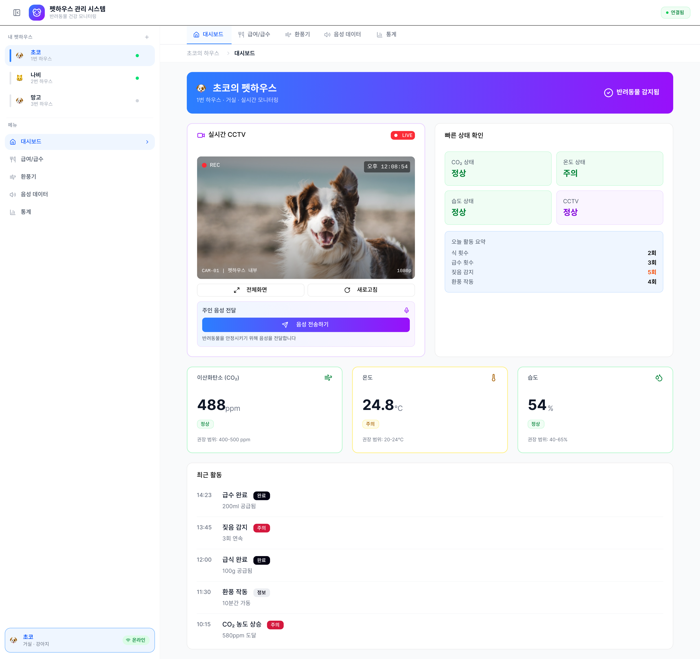
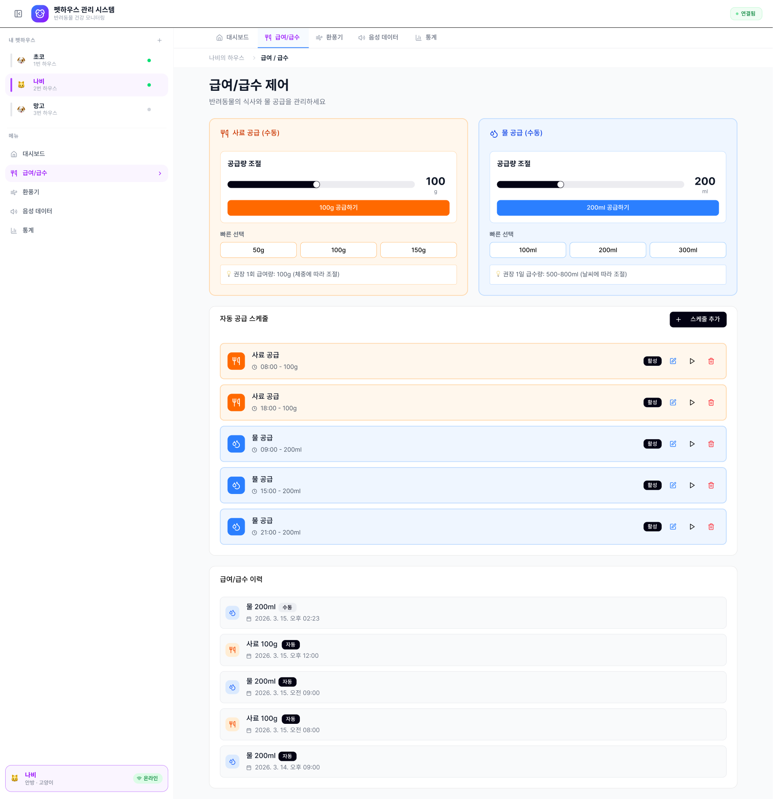
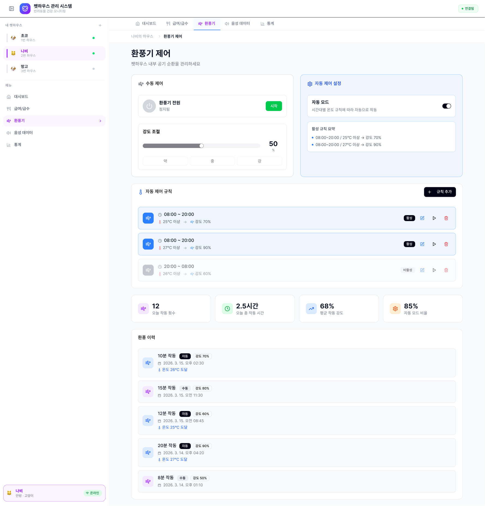
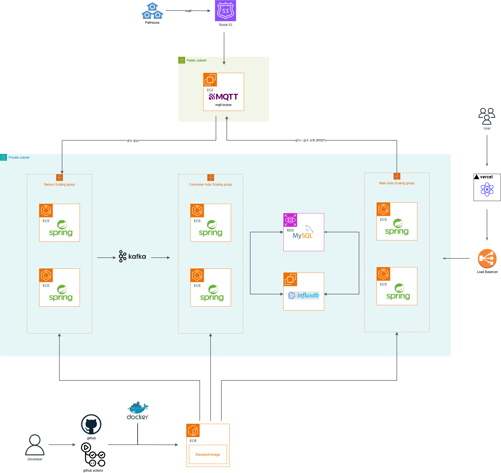
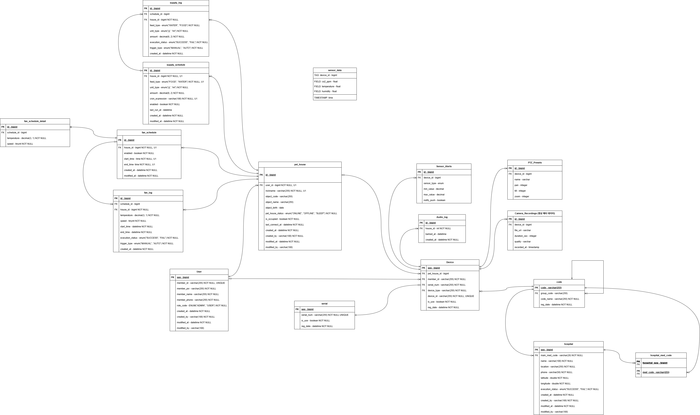

# 펫 하우스 모니터링 서비스

> **IoT 기반 반려동물 스마트 하우스 원격 모니터링 · 제어 플랫폼**

---

## 🖼️ 서비스 주요 화면

<table width="100%">
  <tr>
    <td width="50%" align="center"><b>메인 모니터링 대시보드</b></td>
    <td width="50%" align="center"><b>급여 / 급수 제어 화면</b></td>
  </tr>
  <tr>
    <td></td>
    <td></td>
  </tr>
  <tr>
    <td width="50%" align="center"><b>환풍기 제어 화면</b></td>
    <td width="50%" align="center"><b>센서 통계 및 그래프</b></td>
  </tr>
  <tr>
    <td></td>
    <td></td>
  </tr>
</table>

---

## 🏗️ 시스템 아키텍처

  

- **IoT Sensor Pipeline**: EMQX Broker(Public Subnet) ➔ Spring ECS(Sensor Group) ➔ Apache Kafka ➔ Spring ECS(Consumer Group) ➔ InfluxDB / MySQL 저장 및 WebSocket 실시간 푸시
- **CI/CD Pipeline**: GitHub Actions ➔ Docker Image 빌드 ➔ AWS ECR ➔ AWS ECS 자동 배포

---

## 🗄️ ERD

  

- **핵심 엔티티**: 회원, 펫 프로필, 기기 시리얼 정보, 급여/급수/환풍기 제어 스케줄 설정, 알림 이력 등

---

## 📌 주요 기능

- **실시간 환경 감시 및 원격 제어**: 반려동물이 혼자 있는 환경을 실시간으로 감시하고 기기를 원격 제어합니다.
- **IoT 센서 데이터 실시간 푸시**: MQTT 프로토콜로 펫하우스 기기와 통신하며, $CO_2$·온도·습도 센서 데이터를 InfluxDB에 저장하고 WebSocket을 통해 사용자에게 실시간으로 푸시합니다.
- **자동 스케줄링 및 편의 기능**: 자동 급식·급수·환풍 스케줄링 설정 기능과 주변 반려동물 병원 검색 기능을 제공합니다.
- **어드민(관리자) 관리 시스템**: 등록된 펫하우스 기기 목록 조회/등록/수정/삭제, 기기 시리얼 번호 관리, 서비스 이용 회원 상태 확인 및 회원 수정/삭제 기능을 제공합니다.

---

## 📅 프로젝트 개요

- **기간**: 2026.03 ~ 2026.06 (약 3개월)
- **프로젝트 인원**: 2명

---

## 🛠️ 담당 역할

- **MQTT 인프라 설계 및 구현**: EMQX 브로커 연동, Pub/Sub 기반 데이터 송수신 및 ACK 메커니즘 구축
- **Kafka 기반 센서 데이터 비동기 파이프라인 구축**: `MQTT 수신` ➔ `InfluxDB 저장` ➔ `WebSocket 실시간 푸시` 구조 완성
- **JWT 기반 Stateless 인증 시스템 구현**: Access Token 및 Refresh Token 자동 갱신 구조 설계
- **ORM 쿼리 최적화**: `FetchJoin`과 `default_batch_fetch_size`, `Projection`을 통한 N+1 문제 해결 및 쿼리 호출 최소화
- **DB Indexing 최적화**: 조회가 많지만 데이터 변경이 적은 도메인(펫 하우스 프로필, 급식/급수/환풍기 schedule 등)에 DB Indexing 처리

---

## 💻 사용 기술

### Backend
- **Spring boot 3.5.12**: 웹 애플리케이션 개발을 위한 풍부한 생태계를 기반으로 백엔드 개발
- **Mysql 8.0**: 회원, 기기, 스케줄 등 데이터의 ACID 트랜잭션과 일관성 보장
- **QueryDSL**: 복잡한 동적 쿼리를 컴파일 타임의 안정성을 확보하여 자바 코드로 작성
- **InfluxDB** - 센서(온도·습도·CO₂)의 대량 시계열 데이터를 효율적으로 저장·집계하기 위해
- **MQTT (EMQX)**: IoT 기기와의 경량 비동기 통신을 위해, HTTP 대비 낮은 오버헤드와 QoS 보장
- **Kafka**: 센서 이벤트 및 알림을 비동기로 처리하여, IoT 데이터 수집이 메인 트랜잭션을 블로킹하지 않도록 처리
- **Docker**: 애플리케이션 실행 환경을 컨테이너화 하여 개발 운영 환경 간의 이식성을 보장하기 위해
- **Spring Security & JWT**: Stateless JWT 토큰 기반의 인증으로 웹·앱 클라이언트를 안전하게 식별하기 위해
- **WebSocket & STOMP**: HTTP 폴링 오버헤드 없이 센서 데이터를 클라이언트에 실시간 푸시하기 위해 사용
- **Github Actions**: 코드 push, 빌드, 테스트, 배포까지의 파이프라인을 자동화하여 개발 생산성을 높이기 위해

---

## ⚡ 핵심 트러블 슈팅 및 문제 해결

자세한 분석과 해결 과정, 시퀀스 다이어그램은 각 문서 링크에서 확인하실 수 있습니다.

1. **[대용량 센서 수집 파이프라인 구축: MQTT와 Kafka를 활용한 비동기 분리](./docs/troubleshooting/01-sensor-pipeline.md)**
   - InfluxDB 저장 및 웹소켓 브로드캐스트의 동기식 I/O 지연 전파 문제 해결
   - Kafka 비동기 파이프라인 구축으로 수신 스레드 Non-blocking 전환 및 안정적인 처리 성능 확보

2. **[MqttAckManager: 비동기 MQTT 위에서 동기식 기기 제어 응답 파이프라인 구현](./docs/troubleshooting/02-mqtt-ack-manager.md)**
   - 단방향 Pub/Sub 구조인 MQTT 프로토콜 한계 극복
   - `CompletableFuture`와 `ConcurrentHashMap`을 활용한 최대 10초 내 기기 제어 성공/실패/타임아웃 동기식 응답 처리

3. **[추가 설계 결정 (MQTT 프로토콜, InfluxDB vs MySQL, Kafka)](./docs/troubleshooting/03-extra-design.md)**
   - 양방향 경량 제어를 위한 MQTT 프로토콜 도입 배경
   - 시계열 데이터를 위한 InfluxDB vs MySQL 역할 분리
   - 이벤트 재처리 및 멀티 컨슈머 구조를 위한 Kafka 채택 사유

--- 

## 📝 프로젝트 회고

### 🔍 시스템 검증

* **Kafka 기반 센서 수집 파이프라인 수신·저장 분리**
  * MQTT로 수신한 센서 데이터를 Kafka를 거쳐 InfluxDB에 저장하고 WebSocket(STOMP)으로 푸시하는 수집 파이프라인을 구현.
  * 수신 스레드와 DB 저장 로직을 분리하기 위해 Kafka를 도입 (`partition = 3`, `consumer = 3`).
* **MqttAckManager를 통한 비동기 위 동기식 제어 응답 구현**
  * 기기 명령(급식/급수 요청)과 응답을 `commandId`로 연결하는 `MqttAckManager`를 설계해, 비동기 MQTT 위에서도 사용자가 10초 안에 성공/실패/타임아웃(결과 불명) 중 하나의 응답을 받는 구조를 구현. (QoS 1의 `PUBACK`은 브로커 수신 확인일 뿐 실제 기기 실행을 뜻하지 않음)
* **도메인 특성에 맞춘 DB 선택 (InfluxDB + MySQL)**
  * 수정이 거의 없고 시간 순으로 쌓이며 빠른 Read/Write가 필요한 센서 데이터는 LSM Tree 기반의 InfluxDB를, 회원 및 자동 급식 스케줄처럼 데이터 정합성과 ACID가 중요한 도메인은 MySQL로 분리하여 상황에 맞는 DB를 선택.
* **파이프라인 한계 식별 및 구조 개선점 도출**
  * 코드 검토를 통해 기존 파이프라인의 한계(예외 삼킴 현상, 컨슈머 시각 저장 문제, Partition Key 미지정 등)를 식별하고 개선 방향을 정리.
* **컨테이너화 및 CI/CD 자동화 구축**
  * Docker Compose로 전체 스택(MySQL, InfluxDB, EMQX, Kafka, App)을 구동 환경과 동일하게 구성하고, GitHub Actions를 통해 빌드 ➔ ECR 푸시 ➔ EC2 자동 배포 파이프라인을 구축.

---

### 💡 배운 점

* **메시지 브로커 도입과 시스템 신뢰성의 상관관계 이해**
  * 브로커를 도입했다고 해서 반드시 신뢰성이 생기지 않는 다는 것을 알게 되었다. 컨슈머가 예외를 삼키면 재처리가 불가능해지고, 저장 시각을 컨슈머 시점에서 기록하면 지연 발생 시 저장 시각이 왜곡된다. 구조도 중요하지만, 오류 처리, offset, 시각 설계도 고려해야 한다는 것을 알게 되었다.
* **타임아웃의 정의와 멱등성(Idempotency)의 필요성**
  * 타임아웃은 실패가 아니라 결과 불명이라는 것을 알게 되었다. ACK가 10초 안에 오지 않아도 기기는 명령을 실행했을 수 있다. 사용자가 재시도하면 급식 급여와 같은 동작이 중복될 수 있어, 기기 쪽 멱등 처리와 상태 보정이 필요하다는 것을 알게 되었다.
* **Scale-Out 환경에서의 MQTT 구독 방식 (일반구독 vs 공유구독)**
  * 여러 서버 인스턴스로 수평 확장 시, 같은 Mqtt 구독이라도, 펫 하우스 기기에서 오는 ACK 토픽은 모든 서버 인스턴스가 받는 일반구독, 센서 수집 토픽은 한 인스턴스만 처리하는 공유구독 방식을 채택해야 한다는 것을 알게 되었다.

---

### 🎯 아쉬운 점 및 향후 개선 방향

* **컨슈머 예외 삼킴 문제 및 DLT 도입 필요**
  * **현상**: Kafka는 실패한 메시지를 재처리하기 위해 도입했다. 그러나 Consumer가 예외를 삼키고 로그만 남기면서, 저장에 실패한 메시지가 재시도 없이 오프셋이 진행된다. 이는 영구적인 메시지 유실로 이어진다.
  * **개선**: 예외를 던져 재시도를 수행하고, 최종 실패 시 DLT(Dead Letter Topic) 핸들러로 격리하도록 수정할 계획.
* **컨슈머 생성 시각 사용으로 인한 시계열 저장 시각 왜곡**
  * **현상**: InfluxDB 저장 시각을 컨슈머 실행 시점의 `Instant.now()`로 기록하여, Kafka 지연이나 복구 시 밀려 있던 센서 데이터가 모두 동일 시각으로 저장되어 데이터가 왜곡되는 문제를 발견.
  * **개선**: DB 저장이 아닌 **IoT 기기가 직접 측정한 센서 수신 시각 타임스탬프**를 메시지 DTO에 담아 InfluxDB에 기록하도록 보완할 예정.
* **Kafka Message Key 미지정으로 인한 메시지 순서 역전 위험**
  * **현상**: 메시지 발행 시 Key를 지정하지 않아(`null`), Round-Robin 방식으로 3개 파티션에 분산되어 동일 기기의 센서 메시지 순서가 보장되지 않았다.
  * **개선**: Key를 `deviceId`로 지정하여 동일 기기 메시지가 항상 동일 파티션으로 할당되도록 보장하고, 기기의 측정 시각을 메시지에 포함하여 정합성을 확보할 것입니다.