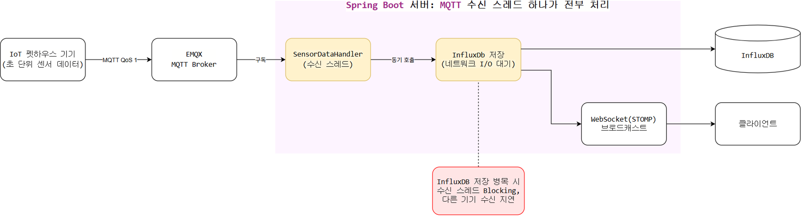
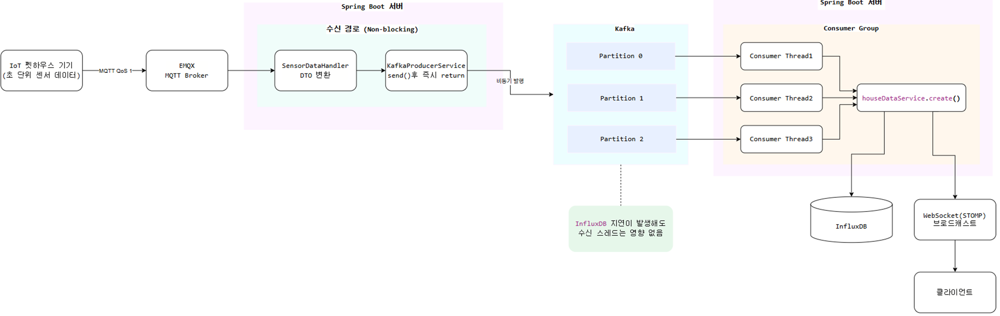

# 1. 대용량 센서 수집 파이프라인 구축: MQTT와 Kafka를 활용한 비동기 분리

---

## ❌ 기존 동기식 처리 방식

### 📌 문제 원인 
- **초 단위 센서 데이터 수신**: 펫하우스 IoT 기기에서 초 단위로 발생하는 온·습도/$CO_2$ 센서 데이터를 백엔드의 MQTT 수신 스레드가 수신.
- **동기식 I/O 처리로 인한 병목**: 수신 스레드가 데이터를 받자마자 InfluxDB 네트워크 I/O 저장과 WebSocket(STOMP) 브로드캐스트 푸시까지 동기식으로 모두 수행.
- **장애 및 지연 전파**: InfluxDB의 일시적인 네트워크 지연이나 디스크 쓰기 병목이 발생할 경우, 네트워크 수신 스레드로 그대로 전파되어 후속 센서 데이터 수신까지 줄줄이 지연·중단.

---

## 💡 비동기 파이프라인 구축 및 개선

### 🛠️ 해결 과정
- **수신 경로 Non-blocking 전환**:
  - MQTT 인바운드 수신 핸들러(`SensorDataHandler`)의 역할을 **"DTO 변환 후 Kafka 토픽 발행"**으로만 최소화.
  - `kafkaTemplate.send()`를 호출한 뒤 발행 완료를 동기적으로 기다리지 않고 즉시 리턴하여 수신 스레드의 대기 시간을 제거.
- **독립 컨슈머 그룹(Consumer Group) 및 병렬 소비 구축**:
  - 별도의 독립 컨슈머 그룹을 구성하여 InfluxDB 저장과 웹소켓 실시간 전송을 전담하도록 책임을 분리.
  - 토픽 파티션을 3개로 분할하고 컨슈머 동시성 설정(`concurrency=3`)을 적용하여 3개의 컨슈머 스레드가 1:1로 매핑되어 병렬로 소비하는 파이프라인을 구축.

---

## 🚀 결과 및 성과

- **안정적인 수신 성능 유지**: 데이터베이스 I/O 병목이나 외부 네트워크 지연이 발생하더라도 Kafka가 중간 버퍼 역할을 수행하므로, 기기들로부터 들어오는 MQTT 센서 수신 스레드가 멈추지 않고 일정한 데이터 수신 처리 성능을 유지.

---

## ⚠️ 아쉬운 점 및 향후 보완 계획

1. **메시지 순서 보장 문제**:
   - **문제**: 메시지 발행 시 `message key`를 지정하지 않아(`null`), 스레드 간 처리 속도 편차로 인해 동일 기기의 센서 데이터가 순서와 다르게 처리될 수 있는 가능성을 발견.
   - **보완점**: `deviceId`를 Key로 지정하여 동일 기기의 데이터는 항상 동일 파티션에 할당되어 순차 처리되도록 보완이 필요.

2. **타임스탬프 왜곡 문제**:
   - **문제**: InfluxDB 적재 시각을 컨슈머가 DB에 쓰는 시점의 서버 시각(`Instant.now()`)으로 기록하여, Kafka 지연이나 서버 재가동 시 밀려 있던 데이터가 한 시점으로 모여 저장되어 시계열 데이터가 왜곡되는 한계가 존재.
   - **보완점**: IoT 기기가 측정한 실제 타임스탬프를 DTO 데이터에 포함시키고, InfluxDB의 Tag + Timestamp 기반 자연 덮어쓰기 특성을 이용해 멱등성을 확보할 계획.