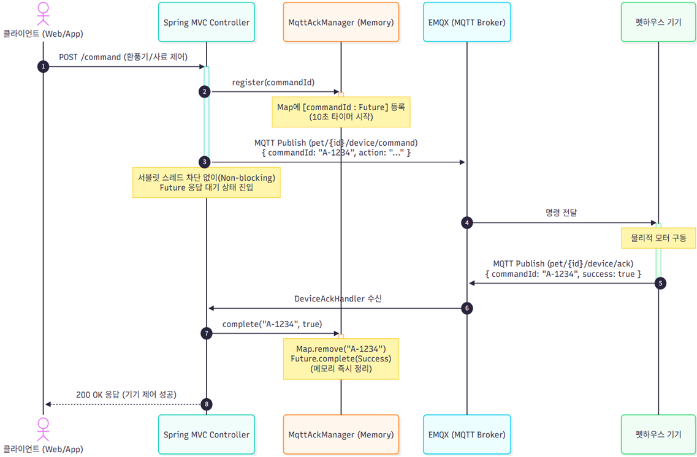

# 2. MqttAckManager: 비동기 MQTT 위에서 동기식 기기 제어 응답 파이프라인 구현

---

## 📐 동기식 기기 제어 흐름도

1. **Client ➔ Spring MVC Controller**: `POST /command` (환풍기/사료 제어 요청)
2. **Controller ➔ MqttAckManager**: `register(commandId)` 
   - ConcurrentHashMap 메모리에 `[commandId : Future]` 등록 및 10초 타임아웃 타이머 시작
3. **Controller ➔ EMQX Broker**: MQTT Publish (`pet/{id}/device/command`, `commandId`, `action`)
   - 서블릿 스레드 차단 없이 `CompletableFuture` 응답 대기 상태 진입
4. **EMQX ➔ 펫하우스 기기**: 물리적 모터 제어 명령 전달 및 구동
5. **펫하우스 기기 ➔ EMQX**: 동작 완료 후 ACK MQTT Publish (`pet/{id}/device/ack`, `commandId`, `success: true`)
6. **EMQX ➔ DeviceAckHandler**: 기기 ACK 수신 및 파싱
7. **DeviceAckHandler ➔ MqttAckManager**: `complete("A-1234", true)`
   - `Map.remove("A-1234")`로 원자적 메모리 즉시 정리 및 `Future.complete(Success)` 처리
8. **Spring MVC Controller ➔ Client**: `200 OK` (기기 제어 성공 응답 반환)

---

## 📌 문제 원인

- **사용자의 즉각적인 응답 기대**: 모바일 앱/웹 사용자는 환풍기 작동이나 사료 급여 같은 물리적 제어 명령을 내릴 때, 하드웨어가 실제로 동작을 완료했는지에 대한 즉각적인 성공/실패 응답을 기대.
- **MQTT 단방향 Pub/Sub의 한계**: MQTT 프로토콜은 Pub/Sub 구조 특성상 명령 발행과 기기의 처리 결과를 직접 연결해 주는 메커니즘이 없음.
- **동기식 응답 필요성**: 비동기 MQTT 프로토콜에서 동기식 성공/실패 응답이 필요.

---

## 💡 해결 과정

- **CompletableFuture 기반 미완료 상태 등록**:
  - 명령 발행 시 고유한 `commandId`를 발급하고, `ConcurrentHashMap<String, CompletableFuture<AckResult>>`에 미완료 상태로 등록한 뒤 기기 제어 토픽으로 메시지를 전송.
- **DeviceAckHandler를 통한 비동기 완료 처리**:
  - 기기가 실제 동작을 마친 후 토픽으로 ACK를 발송하면, 이를 수신한 `DeviceAckHandler`가 해당 `commandId`의 `CompletableFuture`를 완료 처리.
- **`delayedExecutor` 기반 타임아웃 제어**:
  - `delayedExecutor`를 사용하여 10초 내 기기 ACK가 수신되지 않으면 Timeout으로 Future를 자동 완료 처리.
- **원자적 연산을 통한 중복/지연 ACK 처리**:
  - `ConcurrentMap.remove()`의 원자적 연산을 사용해 최초 1회만 Future를 완료하고, 이후 도착하는 지연/중복 ACK는 경고 로그 출력 후 안전하게 무시.

---

## 🚀 결과 및 성과 

- **비동기 기반 동기식 응답 파이프라인 구현 완료**: MQTT 기반 비동기 인프라 위에서 클라이언트가 최대 10초 이내에 **성공 / 실패 / 타임아웃(결과 불명)** 중 하나의 명확한 응답을 받을 수 있는 안정적인 파이프라인을 구축.

---

## ⚠️ 아쉬운 점 및 향후 보완 계획

### 1. ACK 유실/지연으로 인한 중복 명령 실행 위험
- **문제**: 기기가 실제로는 명령을 정상 실행했으나 응답 ACK가 유실되거나 10초보다 늦게 도착하면 서버는 클라이언트에게 타임아웃(결과 불명)을 반환. 사용자가 이를 실패로 인식하여 사료 급여 등의 명령을 재전송할 경우 기기에서 중복 실행될 위험이 존재.
- **보완 방안 1 (상태 확인 응답)**:
  - 동일 펫하우스, 동일 동작에 대해 '결과 불명' 상태의 명령이 진행 중이라면 새 명령을 즉시 보내지 않고 `"이전 명령 확인 중"` 응답을 반환하는 대기 로직을 구현합니다.
- **보완 방안 2 (Redis 기반 멱등성 검증)**:
  - 멱등키를 활용하여 Redis에서 동일 키를 가진 요청이 처리 중인지 확인하고, 현재 처리 중이라면 `"처리 중"` 응답을 반환하여 중복 제어를 차단하는 구조로 개선할 계획.