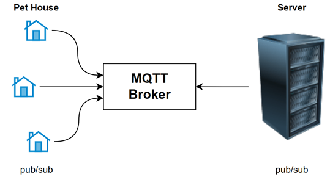
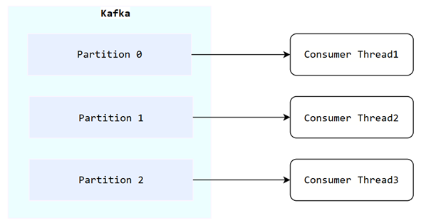

# 3. 추가 설계 결정 (MQTT 프로토콜, InfluxDB vs MySQL, Kafka)

---

## 1. MQTT 프로토콜 선정 및 도입

### 📌 선택 배경
- **초 단위 소형 데이터 연속 전송**: 센서가 초 단위로 작은 데이터를 계속해서 보내고, 서버 또한 기기에 명령을 전달해야 하는 양방향 환경.
- **HTTP Polling 방식의 한계**:
  - 요청마다 TCP 커넥션 재맺기 오버헤드 및 HTTP 헤더 비용이 발생하여 잦은 통신에 부적합.
  - 서버에서 기기로 먼저 제어 명령을 즉시 전달하기 어려움.

### 💡 최종 채택 이유
- **경량화된 연결 유지 (Keep-Alive)**: MQTT는 연결을 항상 유지(Persistent Connection)하는 경량 Pub/Sub 프로토콜로 네트워크 부하와 페이로드 크기를 최대로 줄여줌.
- **단일 연결 기반 양방향 통신**: 센서 수집 데이터 수신, 기기 제어 명령 발행, 제어 응답 ACK 수신을 하나의 MQTT 커넥션 내에서 효율적으로 처리.

---

## 2. 시계열 데이터 저장소: InfluxDB vs MySQL 역할 분리

### 📌 선택 배경
- 펫하우스 환경 센서 데이터는 시간의 흐름에 따라 계속 누적되며, 조회의 대부분이 **"기간별 평균 및 추이 분석"**으로 구성됨.
- RDBMS(MySQL)에 초 단위 센서 데이터를 그대로 `INSERT`할 경우 B-Tree 인덱스 재정렬 오버헤드로 인한 디스크 I/O 병목이 발생.

### 💡 최종 채택 이유

| 구분 | MySQL (RDBMS) | InfluxDB (TSDB) |
| :--- | :--- | :--- |
| **저장 엔진** | B-Tree| **TSM (Time-Structured Merge Tree)** |
| **쓰기(Write) 특성** | Random I/O 및 인덱스 락 발생 가능 | 메모리 & Write Ahead Log(WAL) 기반 **순차 쓰기 최적화** |
| **조회(Read) 특성** | 복잡한 Join 및 트랜잭션 보장 | **시간 단위(Shard) 저장 & 시계열 전용 인덱스**로 기간 검색 최적화 |
| **담당 데이터** | 회원, 기기 정보, 예약 스케줄 등 **ACID 데이터** | 온·습도, $CO_2$ 등 **초 단위 시계열 센서 데이터** |

- **역할의 완전한 분리**: 회원·스케줄처럼 데이터의 정합성과 관계가 중요한 비즈니스 도메인은 MySQL에서 관리하고, 시계열 센서 데이터는 InfluxDB에 분리 저장.

---

## 3. 메시지 브로커: Kafka를 활용한 비동기 파이프라인 채택

### 📌 선택 배경

- **Spring `@Async` 미채택**:
  - 메모리 기반 큐 동작 방식으로 인해 서버 재시작·재배포 시 대기 중인 작업이 사라짐.
  - 단일 JVM 내부 동작 특성으로 인해 작업이 요청을 받은 인스턴스에 묶여 인스턴스 간 분배가 안 됨.
- **RabbitMQ 미채택**:
  - ack된 메시지는 큐에서 삭제되어 과거 이벤트를 되감아 재처리할 수 없음.
  - 알림처럼 한 번 처리하면 끝나는 작업 큐에는 적합해, 다른 프로젝트의 SMS 알림에서는 RabbitMQ를 사용.

### 💡 최종 채택 이유

- **이벤트 로그와 재처리**:
  - 메시지를 보존 기간(retention) 동안 디스크에 보관하므로, 장애 복구 후 컨슈머 오프셋을 되돌려 재처리할 수 있음
- **1:N 멀티 컨슈머 그룹 지원**:
  - 같은 센서 이벤트를 "InfluxDB 적재 컨슈머"와 "WebSocket 실시간 푸시 컨슈머"가 독립 오프셋으로 소비해 서로의 처리 속도에 영향받지 않음.
- **대용량 센서 스트림의 초고속 처리**:
  - OS의 **Page Cache**, **순차 디스크 I/O** 기반이라 이 수집 구조의 쓰기 부하에 적합하다고 판단
